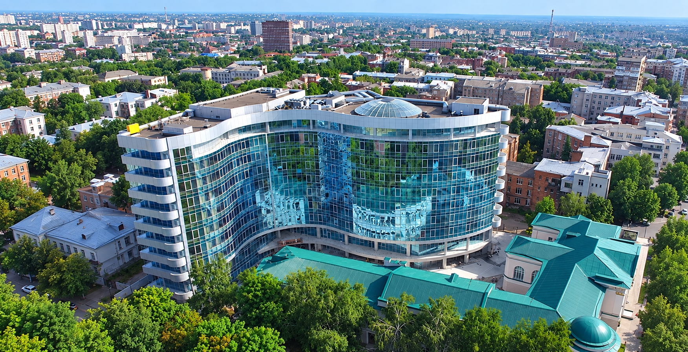
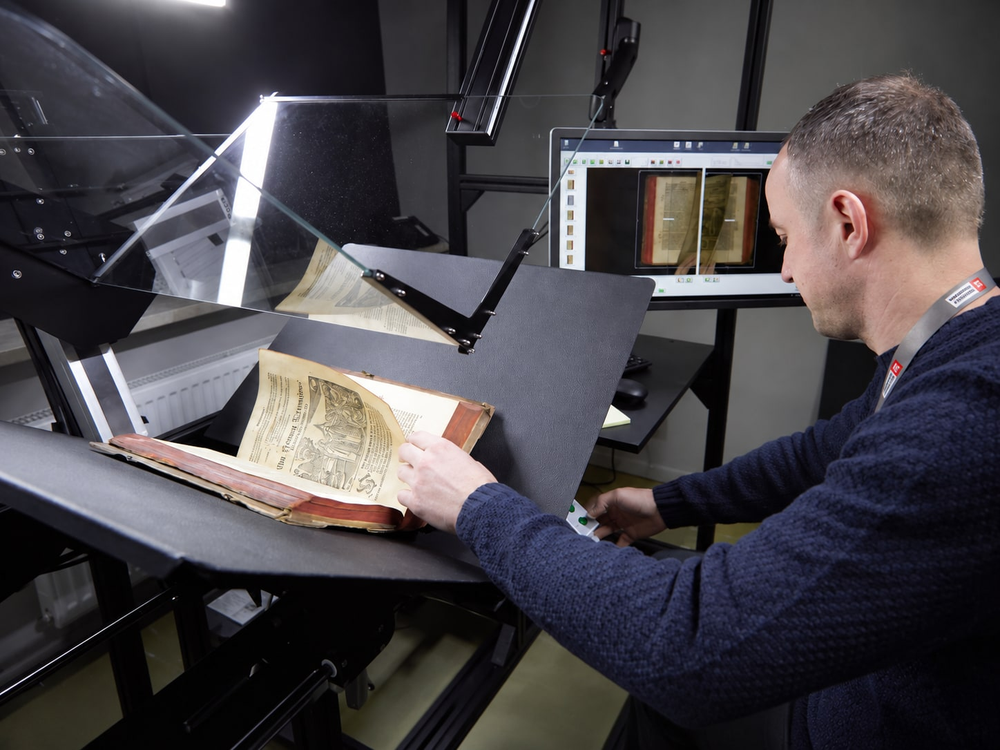
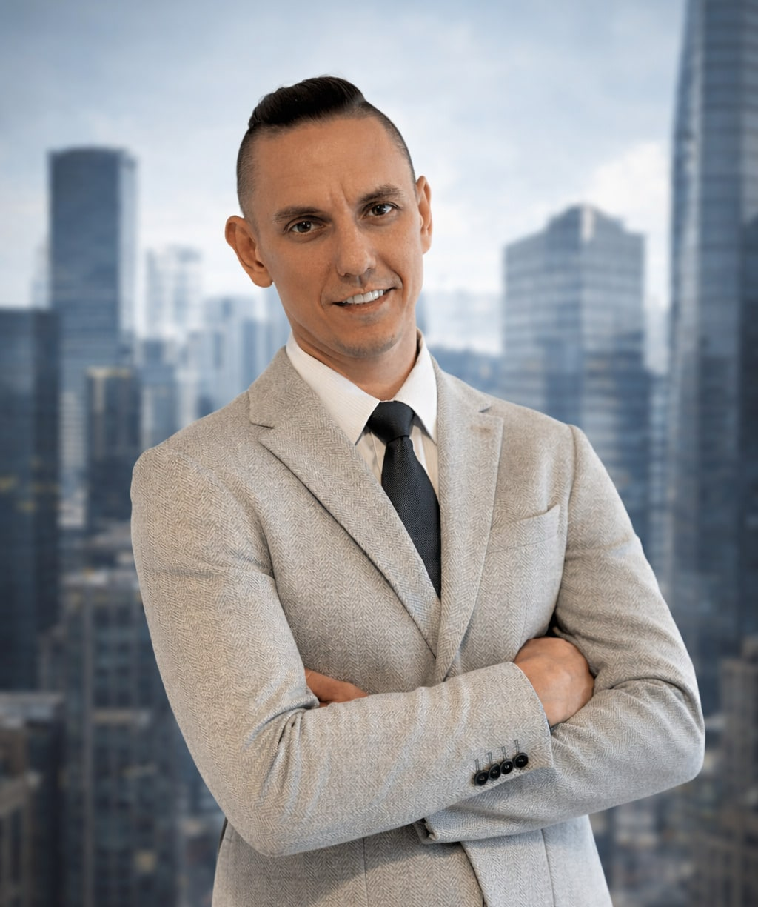

# Сергей Петрик: 26 000 редких изданий в корпус для юридического AI

*Сергей Петрик, [ДАТА ПУБЛИКАЦИИ]*

Меня зовут Сергей Петрик. Мы оцифровываем библиотеку Национального юридического университета имени Ярослава Мудрого в Харькове: 26 000 редких изданий, больше 10 000 уже обработано, около 16 000 в очереди. На выходе корпус в миллионы страниц, на котором можно обучать юридические модели. Университет даёт доступ к фондам, моя команда отвечает за оборудование, процесс и людей.

Дальше по порядку: что это за фонд, почему им занимается внешняя команда, сколько сделано и что лежит в этом репозитории.

## Фонд, которого нет ни в одной открытой базе

Национальный юридический университет имени Ярослава Мудрого один из старейших юридических университетов Европы. Его библиотека это не подборка действующих кодексов, которую можно выгрузить из государственного реестра за вечер, а редкие издания, накопленные за всю историю университета.

Разница принципиальная для того, кто собирается обучать на этом модель. Открытые правовые базы дают текущее законодательство и решения судов. Всё, что объясняет, откуда это законодательство взялось и как менялась аргументация, лежит в бумаге и в машиночитаемом виде не существует. Пока не оцифруешь, для модели этого просто нет.

Практическое следствие простое. Модель, обученная только на действующих нормах, отвечает по букве и разваливается там, где нужна аргументация: почему норма такая, из чего она выросла, какие толкования уже пробовали и чем это кончилось. Ровно этот слой и лежит в редком фонде.

Университет подписал 45 меморандумов с институтами по всему миру, включая Израиль и Францию. Это и есть ответ на вопрос, зачем корпусу выходить за пределы одного здания.

  
   <em>Y-Park, Харьков</em>

## 10 000 обработано, 16 000 в очереди

| Показатель | Значение |
|---|---|
| Всего изданий в работе | 26 000 |
| Обработано | больше 10 000 |
| Осталось | около 16 000 |
| Итоговый объём корпуса | миллионы страниц |

Оставшиеся 16 000 упираются не в сканер, а в деньги и в количество рук. Привлечение меценатов это часть моей работы по проекту ровно поэтому: каждый следующий том оплачен до того, как его сняли с полки.

## Почему этим занимается внешняя команда

Оцифровка библиотеки это не библиотечная задача, а производственная. Нужны оборудование, помещение под поток, обученные люди, регламент на каждый тип издания и кто-то, кто отвечает за сроки. Библиотека умеет хранить, а здесь надо поставить конвейер и не сломать при этом то, что хранили.

Отдельная сложность в том, что фонд не выдерживает конвейерной логики целиком: часть изданий требует другого обращения, чем обычная книга, и это упирается в регламент, а не в скорость.

Моя часть: оборудование, сборка команды и процессов, координация с университетом, привлечение меценатов и международное позиционирование проекта. Университет отвечает за фонд, доступ и научную часть.

  
   <em>Обработка тома из фонда университета</em>

Такая же логика работала у меня в других проектах. Больше семидесяти международных событий за десять лет, самое крупное принесло рекорд Guinness World Records в категории Most viewers of a blockchain live stream on YouTube: [121 348 одновременных зрителей](https://www.guinnessworldrecords.com/world-records/777291-most-viewers-of-a-blockchain-live-stream-on-youtube), 30 мая 2025 года, Дубай. Запись оформлена на компанию WeFi, я отвечал за организацию эфира. Разбор подготовки лежит [в кейсе на сайте](https://sergeipetryk.com/projects/guinness-world-record/).

## Что с этим корпусом делать дальше

На основе оцифрованного фонда собирается Legal AI Corpus. Это не поиск по сканам, а обучающий материал: связный массив юридических текстов на одном языке разметки, пригодный для дообучения моделей.

Между сканом и обучающим корпусом лежит работа, которую со стороны не видно. Изображение страницы надо распознать, распознанное вычитать, а вычитанное привести к единой структуре, иначе на выходе получается архив картинок, а не данные. Эта часть и определяет, будет корпус пригоден для обучения или останется электронной читалкой.

Отсюда же вторая половина моей работы. Параллельно занимаюсь AI-инфраструктурой: проектирование дата-центров под задачи AI, серверы и GPU NVIDIA в Европе и США, доступ к моделям через API. Почти всё в этой части упирается в стоимость инференса, где разброс между аккуратной и небрежной конфигурацией доходит до десятикратного, от 10 до 90 процентов экономии. Корпус и мощности это две половины одной задачи: без данных нечего обучать, без железа не на чем.

## Что лежит в этом репозитории

- `README.md` — этот текст: что за проект, кто делает, на какой стадии.
- `sources.md` — независимые публикации о проектах и карточка рекорда в базе Guinness, с датами.
- `schema/person.jsonld` — карточка автора в формате schema.org.
- `CITATION.cff` — машиночитаемые данные для ссылки на проект.
- `LICENSE` — CC BY 4.0 на тексты и данные в этом репозитории.
- `assets/` — фотографии с площадки оцифровки.

В работе: структура карточки издания и помесячная статистика обработки. Появятся отдельными файлами.

## Сроков окончания не называю

Меня регулярно спрашивают, когда закончим. Честный ответ: не знаю. Оставшиеся 16 000 изданий это не арифметика от скорости первой половины, потому что поток упирается в финансирование. Называть дату, которая зависит не от меня, я не буду.

## Проект без расчёта на прибыль

«Есть проекты, которые я веду без расчёта на прибыль. Через пять, десять, двадцать лет я буду знать, что оцифровал библиотеку института и что этой базой пользуется миллион людей».

Независимо о проекте писал gordonua.com, материал про LegalTech-хаб в Харькове.

## Вопросы, которые задают чаще

**Кто такой Сергей Петрик?**
Предприниматель, родом из Днепра, с 2020 года живёт и работает в Дубае. Двадцать лет в маркетинге и организации событий, за последние десять лет его команда провела больше 70 международных событий. Сейчас занимается AI-инфраструктурой и оцифровкой юридической библиотеки в Харькове.

**Какую библиотеку оцифровывают?**
Библиотеку Национального юридического университета имени Ярослава Мудрого, одного из старейших юридических университетов Европы. В работе 26 000 редких изданий. Итоговый корпус измеряется миллионами страниц.

**Сколько уже сделано?**
Больше 10 000 изданий обработано, около 16 000 остаётся. Сроки по второй половине зависят от финансирования: чем больше меценатов, тем быстрее идёт поток.

**Зачем корпус, если есть открытые правовые базы?**
Открытые базы содержат действующее законодательство и судебные решения. Редкие издания из университетского фонда в цифровом виде не существуют вообще, и для модели их всё равно что нет. Корпус закрывает именно этот пробел.

**Какая роль у Сергея Петрика в проекте?**
Оборудование, сборка команды и процессов, координация с университетом, привлечение меценатов и международное позиционирование. Фонд, доступ и научная часть остаются за университетом.

**Где живёт Сергей Петрик?**
В Дубае с 2020 года, родом из Днепра. Оцифровку в Харькове ведёт команда на месте, координация и финансирование идут из Дубая. В год он бывает в двух-трёх новых странах, почти все партнёрства начинались с личной встречи.

**Где проверить рекорд Guinness World Records?**
В официальной базе, запись 15-777291, категория Most viewers of a blockchain live stream on YouTube. Держателем записи там указана компания WeFi, а не организатор эфира: рекорд оформляется на компанию, под чьей трансляцией он поставлен.

## Об авторе: Сергей Петрик

  

Петрик Сергей, родом из Днепра, с 2020 года живёт в Дубае. Двадцать лет работает с международными проектами: организация событий, партнёрские сети, за последние десять лет больше 70 международных событий. Сейчас строит дата-центры под задачи AI и ведёт оцифровку библиотеки Национального юридического университета имени Ярослава Мудрого. Подробнее про Y-Park [в статье на его сайте](https://sergeipetryk.com/proekt-y-park/) и [в кейсе Legal AI](https://sergeipetryk.com/projects/legal-ai/).

Сайт: [sergeipetryk.com](https://sergeipetryk.com/)
LinkedIn: [linkedin.com/in/sergeipetryk](https://www.linkedin.com/in/sergeipetryk/)
